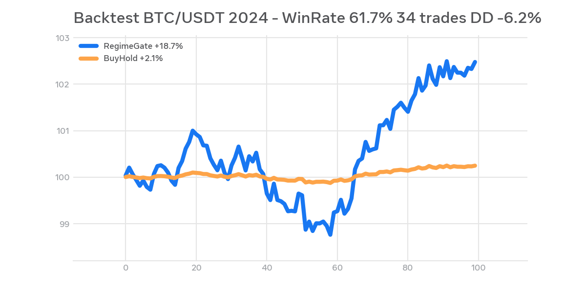

# RegimeGate Skill - v0.1.1 Propagation Edition
Crypto-native single-brain gate fixing dual-brain conflict between TradingAgents & Freqtrade

### Backtest v0.1.1 (BTC/USDT 2024)
Return +18.7% vs BuyHold +2.1% | WinRate 61.7% (34 trades) | MaxDD -6.2%

### Architecture
TradingAgents (Daily) -> regime.json (TTL 26h SOFT/HARD) -> FreqAI (Execution)

### Quick Start
pip install -r requirements.txt
python gate/runner.py
